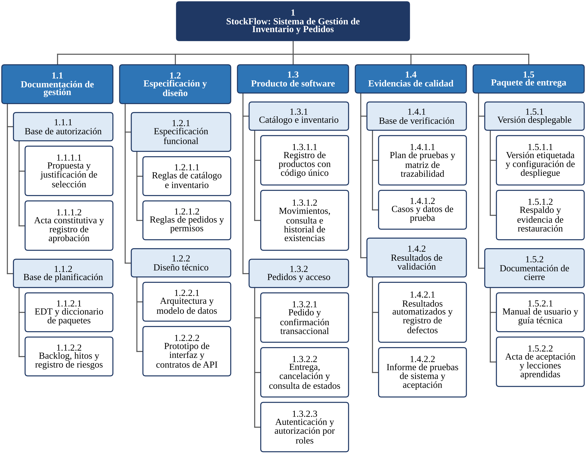

# StockFlow

Sistema web interno de gestión de inventario y pedidos para **Nativa Market S.A.** (empresa ficticia), una tienda en línea de Heredia, Costa Rica.

Proyecto del curso **Pruebas y Aseguramiento de la Calidad del Software** – ULACIT.

## Equipo

| Integrante | Rol |
|---|---|
| Reynaldo Andrés Gutiérrez Solano | PM y Scrum Master |
| Marco Andros Dávila Morales | Analista / Product Owner |
| Randy Jiménez Cruz | Arquitecto y desarrollador líder |
| Emmanuel Miranda Gómez | Líder de calidad (QA) |

## ¿Qué problema resuelve?

La tienda lleva el inventario en hojas de Excel y recibe pedidos por la web, WhatsApp e Instagram. Eso causa códigos repetidos, inventario que no cuadra y sobreventas. StockFlow centraliza productos, inventario y pedidos, y guarda el historial de cada movimiento.

## Alcance

**Incluye:** usuarios con roles, catálogo con código único, entradas y ajustes de inventario, pedidos (crear, confirmar, entregar y cancelar) y consultas.

**No incluye:** tienda pública, pagos, facturación electrónica, contabilidad ni app móvil.

## Tecnología

- **Arquitectura:** web de tres capas con API REST
- **Frontend:** HTML, CSS y JavaScript
- **Backend:** Python + Flask
- **Base de datos:** SQLite
- **Herramientas:** VS Code, Git/GitHub, GitHub Projects, Figma, Postman
- **Metodología:** Scrum con sprints de dos semanas

## Estructura del repositorio

```
docs/
  edt.png        Estructura de desglose del trabajo (EDT)
src/             Código fuente
tests/           Pruebas
```

## EDT



## Backlog

Las historias de usuario están en la pestaña **Issues** y en el tablero de **Projects** del repositorio.
